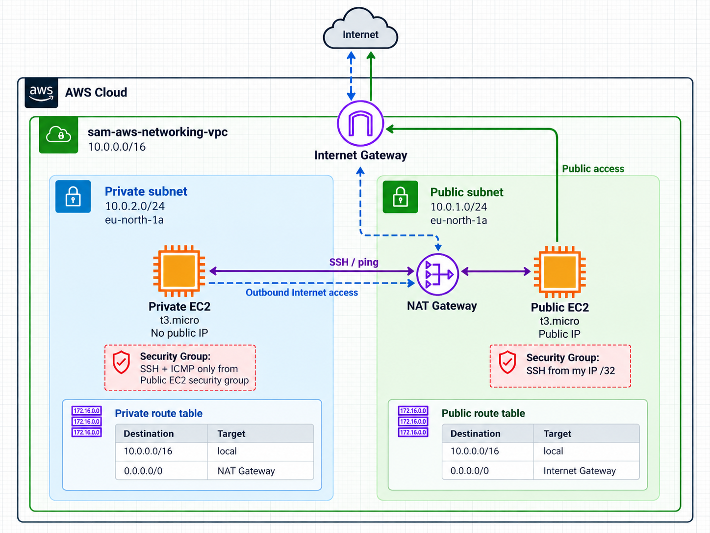
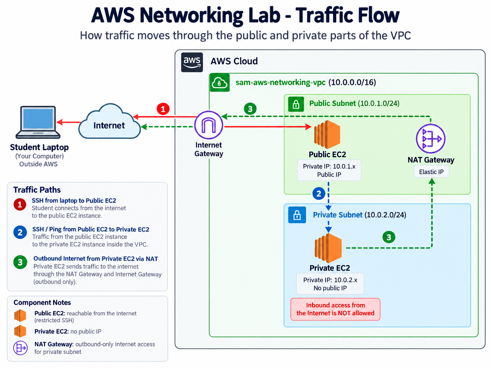

# AWS Networking Lab

A small AWS network built entirely with Terraform: one VPC with a public and a private subnet, an Internet Gateway, a NAT Gateway, route tables, Security Groups and one EC2 instance in each subnet. The goal is to understand how public and private networking works in AWS and to prove it with real tests.



*The whole lab in one picture: one VPC, a public and a private subnet, and the gateways and route tables that connect them.*

## What was built

- A VPC (`10.0.0.0/16`) in `eu-north-1` (Stockholm), with one public subnet (`10.0.1.0/24`) and one private subnet (`10.0.2.0/24`) in the same Availability Zone.
- An Internet Gateway and a public route table that sends internet traffic to it.
- A NAT Gateway with an Elastic IP in the public subnet, and a private route table that sends internet traffic to it.
- A public EC2 instance with a public IP, reachable by SSH from one address only.
- A private EC2 instance with no public IP, reachable only from the public instance.
- An SSH key pair created by Terraform from a local public key. The private key never enters the repository or the Terraform state.

In total the configuration creates 20 resources. The full story, with the reasoning behind each decision, is in the [project record](project-record/PROJECT-RECORD.md).

## Technologies

AWS (VPC, EC2, NAT Gateway, Elastic IP, Security Groups), Terraform, AWS CLI, Amazon Linux 2023, SSH, Git.

## How the network behaves



*The three traffic paths that were tested: (1) laptop to the public instance, (2) public instance to the private instance, (3) private instance to the internet through the NAT Gateway.*

- A subnet is public only because its route table sends `0.0.0.0/0` to the Internet Gateway. The private subnet has no such route.
- The private instance reaches the internet through the NAT Gateway, which sits in the public subnet. The internet cannot start a connection to the private instance.
- SSH to the public instance is allowed from one `/32` address only. The private instance accepts SSH and ping only from the public instance's Security Group.

## Terraform workflow

```
terraform fmt
terraform init
terraform validate
terraform plan
terraform apply
terraform destroy
```

The plan was reviewed before apply, and the apply used a saved plan file. A personal `terraform.tfvars` (not in the repository) holds the allowed SSH address. `terraform.tfvars.example` shows the format.

## Verification

Terraform reporting success was not treated as proof. The result was checked in AWS and with real connections:

- The route tables, NAT Gateway, Security Group rules and instance settings match the design.
- SSH from the local machine to the public instance works, and from there to the private instance.
- The public instance pings the private instance (3 of 3 replies).
- The private instance reaches the internet, and the address it appears from is the NAT Gateway's Elastic IP.
- The private instance cannot be reached directly from the internet.

| | |
|---|---|
|  |  |
| VPC resource map in the AWS Console | Private route table pointing to the NAT Gateway |
|  |  |
| Private instance appearing from the NAT Gateway's IP | Final Terraform plan: 20 to add |

## Repository structure

```
.
├── README.md
├── terraform/
│   ├── versions.tf            Terraform and provider versions
│   ├── providers.tf           AWS provider, region, default tags
│   ├── variables.tf           Input variables
│   ├── networking.tf          VPC, subnets, gateways, route tables
│   ├── security.tf            Security Groups and rules
│   ├── compute.tf             Key pair and the two EC2 instances
│   ├── outputs.tf             IP addresses and VPC ID
│   └── terraform.tfvars.example
└── project-record/
    ├── PROJECT-RECORD.md      Detailed write-up of the project
    └── screenshots/              Diagrams and evidence
```

## Cost

The NAT Gateway, the Elastic IP and the public IPv4 address are billed by the hour, so the lab is meant to run only while it is being tested and documented. It is removed with `terraform destroy` afterwards.
