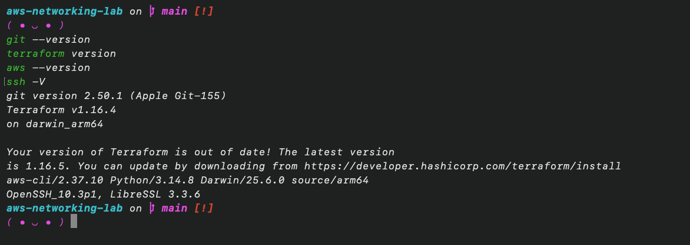
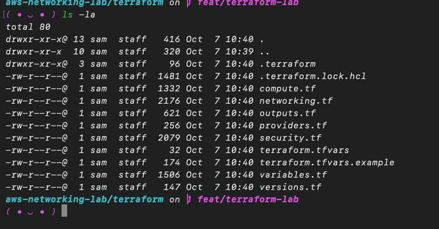
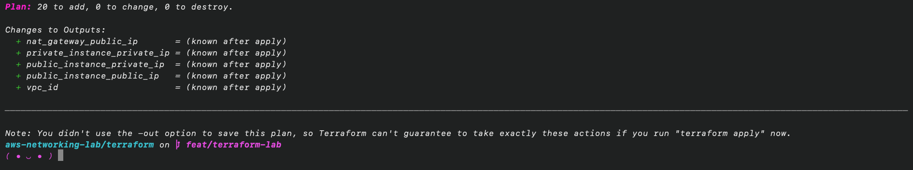
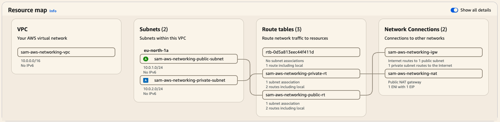
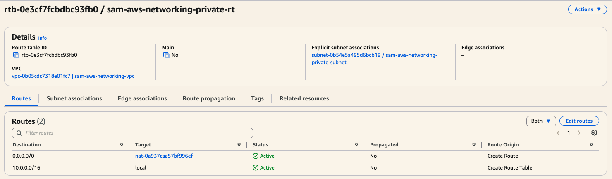
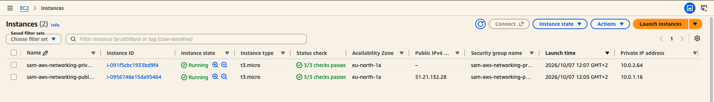
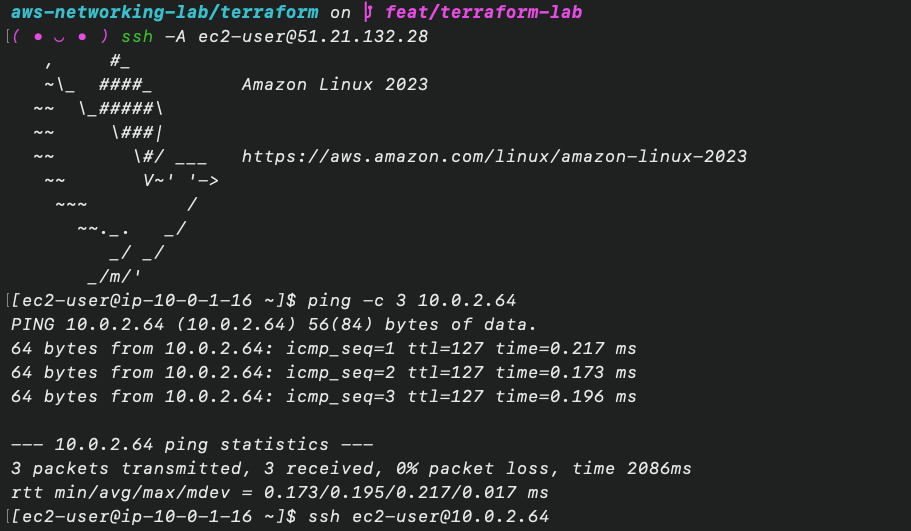
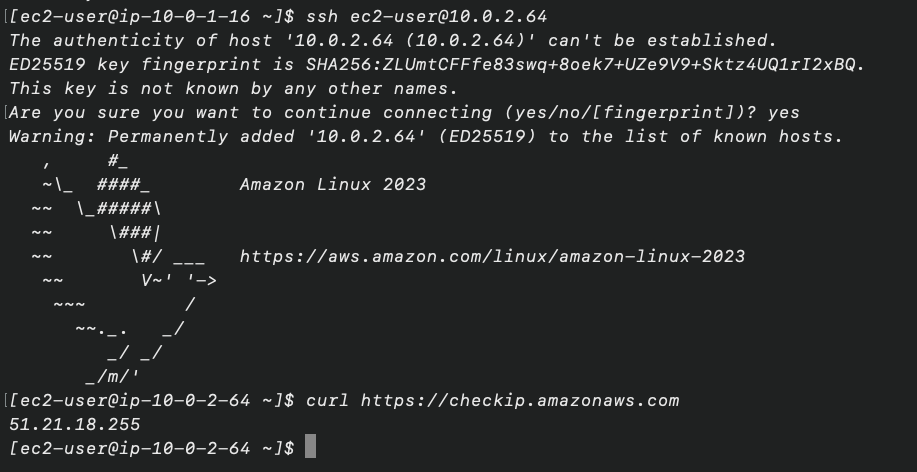

# AWS Networking Lab - Project Record

## Planning and environment

Before any Terraform code is written, it is checked that Git, Terraform, the AWS CLI and SSH are installed.

```
git --version
terraform version
aws --version
ssh -V
```



All four tools are installed and working. Terraform reports a newer patch release (1.16.5), which does not matter for this lab.

The AWS CLI access also works, and Stockholm (`eu-north-1`) was chosen as the region for the project. It has enough Availability Zones and supports the small EC2 instance type planned for the lab, so there was no reason to look at another region. The default VPC that AWS creates in every account is intentionally left untouched, and the lab is built inside its own VPC.

## Terraform design

The whole lab is described in Terraform, split into a few small files so each one can be explained on its own: `networking.tf` (VPC, subnets, gateways, route tables), `security.tf` (Security Groups), `compute.tf` (the two EC2 instances), plus the usual `versions.tf`, `providers.tf`, `variables.tf` and `outputs.tf`. No modules are used, because the project is small enough to be read from top to bottom.



The `terraform.tfvars` file in the listing holds local values and is ignored by Git. The `.terraform` folder is ignored too, while the lock file is committed.

**Address ranges.** The VPC uses `10.0.0.0/16`, the public subnet `10.0.1.0/24` and the private subnet `10.0.2.0/24`. A private 10.x range was chosen because it does not overlap with the default VPC (`172.31.0.0/16`) that already exists in the account. The /24 subnets give 251 usable addresses each, which is far more than needed and still easy to read.

**Public versus private.** The two subnets are defined almost the same way. The public subnet is public only because its route table sends internet traffic (`0.0.0.0/0`) to the Internet Gateway. The private route table sends the same traffic to the NAT Gateway instead, and has no route to the Internet Gateway. The NAT Gateway itself sits in the public subnet, since it needs the Internet Gateway route to reach the internet, and it has an Elastic IP as its fixed public address.

**Instances.** Both instances are `t3.micro` with the latest Amazon Linux 2023 image. The image is looked up through the public AWS parameter for Amazon Linux instead of a hard-coded AMI ID, so the code does not go out of date. Only the public instance gets a public IP address.

**SSH access.** The key pair is created by Terraform too, so access to the instances is part of the code and can be rebuilt with it. Only the public half of a dedicated local key is uploaded. The private key stays on the local machine, outside the repository, because a private key must never end up in code, Git or the Terraform state. Both instances use the same key pair, and the private one is reached by jumping through the public one.

**Security Groups.** The public instance accepts SSH only from one address, the public IP of the machine running the lab, and never from `0.0.0.0/0`. The private instance accepts SSH and ping only from the public instance's Security Group, so the only way into it is through the public instance. Both allow all outbound traffic, which for the private instance leaves through the NAT Gateway.

**Sensitive values.** The real IP address is kept in a local `terraform.tfvars` that Git ignores. The repository only contains `terraform.tfvars.example` with a placeholder. No credentials are written anywhere, because Terraform uses the existing AWS CLI login.

### What the plan shows

`terraform fmt`, `init`, `validate` and `plan` all ran cleanly. The plan creates 20 resources and changes or destroys nothing: the VPC, two subnets, the Internet Gateway, two route tables with their associations, the Elastic IP, the NAT Gateway, two Security Groups with five rules, the SSH key pair, and the two instances. In the plan the private instance has no public IP, and its only default route points to the NAT Gateway.



The end of the plan output shows the total of 20 resources to add. Nothing exists in AWS yet, because the plan was not applied.

## Deployment and verification

The reviewed configuration was applied, and all 20 resources were created without errors. The NAT Gateway was the slowest part, taking a little under two minutes to become available.

Terraform reporting success is not enough, so the result was checked directly in AWS:

- The public subnet (`10.0.1.0/24`) routes `0.0.0.0/0` to the Internet Gateway, and the private subnet (`10.0.2.0/24`) routes `0.0.0.0/0` to the NAT Gateway. The NAT Gateway is in the public subnet and uses its own Elastic IP.
- The public instance has a public IP, and SSH to it works with the project key. Its outgoing traffic leaves with its own public address.
- The private instance has only a private IP (`10.0.2.x`), no public IP, and no route to the Internet Gateway.
- Both instances use the same key pair, and the Security Group rules are exactly the ones planned: SSH to the public instance from one address only, and SSH and ping to the private instance from the public instance's Security Group only.



The resource map in the AWS Console shows the same design: both subnets, the two route tables created for the lab, and the Internet Gateway and NAT Gateway they connect to. The third route table is the main one that AWS adds to every VPC automatically. It has no subnets and is not used.



The private route table sends `0.0.0.0/0` to the NAT Gateway, keeps `10.0.0.0/16` local, and is associated with the private subnet only.



The instance list shows both instances running, with a public IPv4 address only on the public one.

## Connectivity verification

The idea of the test is simple: the public instance is the only way in, and the private instance can only reach the internet through the NAT Gateway.

- **Local machine to public instance.** SSH with the project key works.
- **Public instance to private instance.** SSH works from the public instance (reached with the same key through the public instance), and a ping from the public instance to `10.0.2.64` gets 3 replies out of 3. Both are allowed only because the private Security Group accepts traffic from the public Security Group.
- **Private instance to the internet.** A request to `checkip.amazonaws.com` from the private instance returns `51.21.18.255`, which is the Elastic IP of the NAT Gateway, not an address of the instance itself. The instance has no public IP, so this shows that the outbound traffic really leaves through the NAT Gateway. A request to `aws.amazon.com` returns HTTP 200.
- **Internet to private instance.** Not possible by design. The instance has no public IP, its subnet has no route to the Internet Gateway, and its Security Group accepts nothing from the internet. From the local machine, SSH and ping to `10.0.2.64` just time out.



Logged in to the public instance, the private instance answers all three pings.



After the SSH hop to the private instance, the address it reports to the internet is the Elastic IP of the NAT Gateway.

For comparison, the same check on the public instance returns its own public IP, because its traffic goes out directly through the Internet Gateway.
